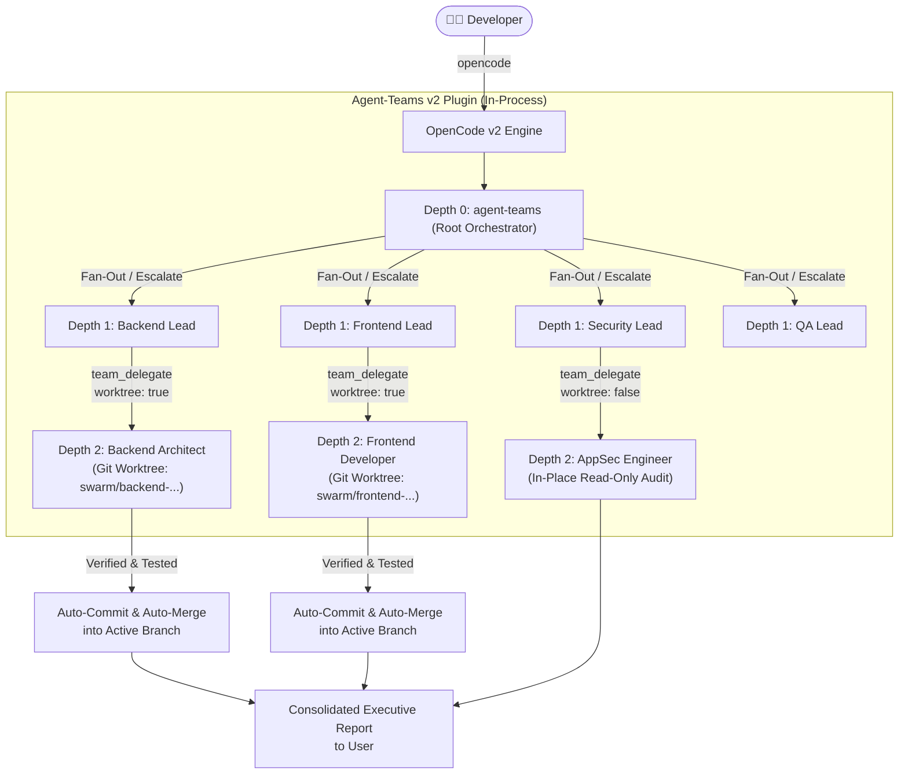

<div align="center">
  <h1>⚡ OpenCode Agent-Teams v2</h1>
  <p><strong>Native Hierarchical Multi-Agent Swarms & Automated Git Worktree Sandboxing for OpenCode v2</strong></p>

  <p>
    <a href="https://www.npmjs.com/package/@mdsohail99/opencode-agent-teams"></a>
    
    
    
    
  </p>
</div>

---

## 📖 Overview

**`@mdsohail99/opencode-agent-teams`** is the official **native multi-agent orchestration plugin** for [OpenCode v2](https://github.com/sst/opencode) (`@opencode/cli@2.1.1`).

In v1, running multi-agent swarms required external Node.js relay daemons, port tokens, and background socket connections. 
**In v2, the relay is completely eliminated.** 

Agent-Teams v2 runs **100% in-process** using OpenCode's native `@opencode/plugin` and `@opencode/client` architecture. It enables high-performance **2-level hierarchical swarms** (`subagent_depth = 2`), **isolated Git worktree sandboxing**, and real-time swarm steering with **zero background processes, zero localhost ports, and zero configuration bloat**.

---

## 🏗️ v2 Swarm Architecture



---

### 🔄 Hub-and-Spoke: The Delegating Agent as Escalation Resolver

In multi-agent swarms, letting specialists or leads call arbitrary peer agents causes unbounded circular recursion and write collisions. Agent-Teams enforces a strict **Hub-and-Spoke Management by Exception** protocol:

1. **Strict Department Scoping:** Department Leads (`backend`, `frontend`, `qa`, etc.) can only dispatch their own subagent specialists. A lead *never* launches a peer department lead directly.
2. **Management by Exception (`ESCALATE`):** If a lead encounters a cross-cutting blocker (e.g., `qa` detects an unhandled backend endpoint, or `frontend` requires a new authentication schema), the lead immediately returns:
   ```text
   ESCALATE: <dept> | WHAT: <need> | WHERE: <file/module> | CONTEXT: <work done + blocker details>
   ```
3. **The Delegating Agent Resolves:** The root orchestrator (`agent-teams`) acts as the central **Escalation Resolver**:
   - It intercepts the escalation without terminating the caller.
   - It checks whether the target department lead is already running (to reuse active session memory) or spawns it inside an isolated Git worktree (`swarm/...`).
   - Once the fix is verified and merged, `agent-teams` hands the context back to the originating lead, allowing it to complete its remaining work seamlessly.

---

## ✨ Key Features in v2

* **🚀 100% In-Process Native Plugin**: Built directly on `@opencode/plugin@2.1.1` and `@opencode/client@2.1.1`. No external relay daemons, no background servers, no socket tokens, and zero orphaned processes.
* **🌳 2-Level Hierarchical Swarms (`subagent_depth = 2`)**: Out-of-the-box support for nested multi-agent trees:
  * **Depth 0**: Root Orchestrator (`agent-teams`)
  * **Depth 1**: Department Leads (`backend`, `frontend`, `security`, `qa`, `devops`, `ai-data`)
  * **Depth 2**: 68 Curated Domain Specialists (`backend-architect`, `api-tester`, `a11y-auditor`, `threat-detection-engineer`, etc.)
* **🛡️ Automated Git Worktree Sandboxing**: Never suffer from file collisions when parallel agents write code. `team_delegate(worktree: true)` creates dedicated branches (`swarm/...`), allows the agent to build and test in isolation, auto-commits verified changes, and merges back to your working branch cleanly.
* **🛠️ Swarm Control Tooling**:
  * `team_delegate`: Dispatch tasks with optional Git worktree sandboxing.
  * `team_status`: Inspect live progress, deliverables, and active Git worktrees.
  * `team_broadcast`: Steer running teammates with instructions simultaneously.
  * `team_terminate`: Gracefully halt workers and discard unneeded worktrees.
* **⌨️ Dynamic In-Memory Slash Commands**: `/team`, `/team-status`, and `/team-stop` are injected dynamically at runtime via `ctx.command.transform()`. Zero hardcoded bloat in your `opencode.json`.
* **🎨 Clean Interactive TUI Installer**: Running the CLI with no arguments launches a full-featured terminal menu to inspect status, install globally, or cleanly uninstall.
* **🧹 Manifest-Tracked Clean Uninstall**: Installs a `.agent-teams-manifest.json` tracking all 75 curated agents. Running `uninstall` deletes strictly the plugin-owned files, preserving any custom agents you added.

---

## ⚡ Quickstart & Installation

### Option 1: Automatic Installer (Global - Recommended)

Run the interactive setup tool:

```bash
npx @mdsohail99/opencode-agent-teams
```

This automatically:
1. Configures your global `~/.config/opencode/opencode.json` with `"subagent_depth": 2` and registers the plugin.
2. Copies the 75 curated Department Leads and Specialists into `~/.config/opencode/agents/`.

---

### Option 2: Declarative Config

Add the plugin to your global `~/.config/opencode/opencode.json` (or your project's `./opencode.json`):

```json
{
  "$schema": "https://opencode.ai/config.json",
  "subagent_depth": 2,
  "plugins": [
    "@mdsohail99/opencode-agent-teams"
  ]
}
```

---

## 🎮 How to Use in OpenCode

1. **Launch OpenCode**:
   ```bash
   opencode
   ```
2. **Select Agent-Teams**:
   * Press **`Ctrl + x`** followed by **`a`**, then select `agent-teams`.
   * *Or* press **`Shift + Tab`** to cycle agents.
   * *Or* mention `@agent-teams` directly in your prompt.

### Example Prompts:

#### 1. Full-Stack Parallel Feature Build (Isolated Worktrees)
> *"Build user authentication: have Backend implement the JWT endpoints in `src/routes/auth.js` while Frontend creates the login dialog in `src/components/LoginModal.tsx`."*
- **What happens:** Backend and Frontend each receive dedicated Git worktrees. Both code simultaneously. Changes are auto-tested and merged back into your active branch.

#### 2. Comprehensive Read-Only Architectural Audit
> *"Run an architectural audit across this repository. Strict read-only mode: inspect API routes, state management, and edge cases in parallel without creating files."*
- **What happens:** The Orchestrator dispatches `backend`, `frontend`, and `security` in-place, returning an integrated Executive Findings Report.

---

## 🕹️ Swarm Slash Commands

| Command | Action |
| :--- | :--- |
| **`/team`** | Displays a live ASCII hierarchy tree showing which agents are running, active worktrees, and elapsed times. |
| **`/team-status`** | Synthesizes current progress and deliverables across all active departments. |
| **`/team-stop`** | Gracefully terminates active background workers and cleans up their worktrees. |

---

## 🗑️ Clean Uninstallation

To remove Agent-Teams globally without touching any custom user agents or personal config:

```bash
npx @mdsohail99/opencode-agent-teams uninstall
```

---

## 📄 License

MIT © [Sohail Mohammed](https://github.com/mdsohail99)
